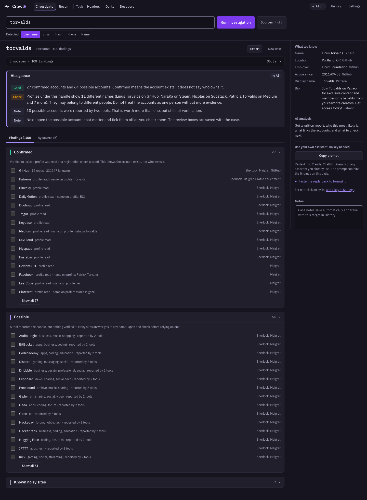
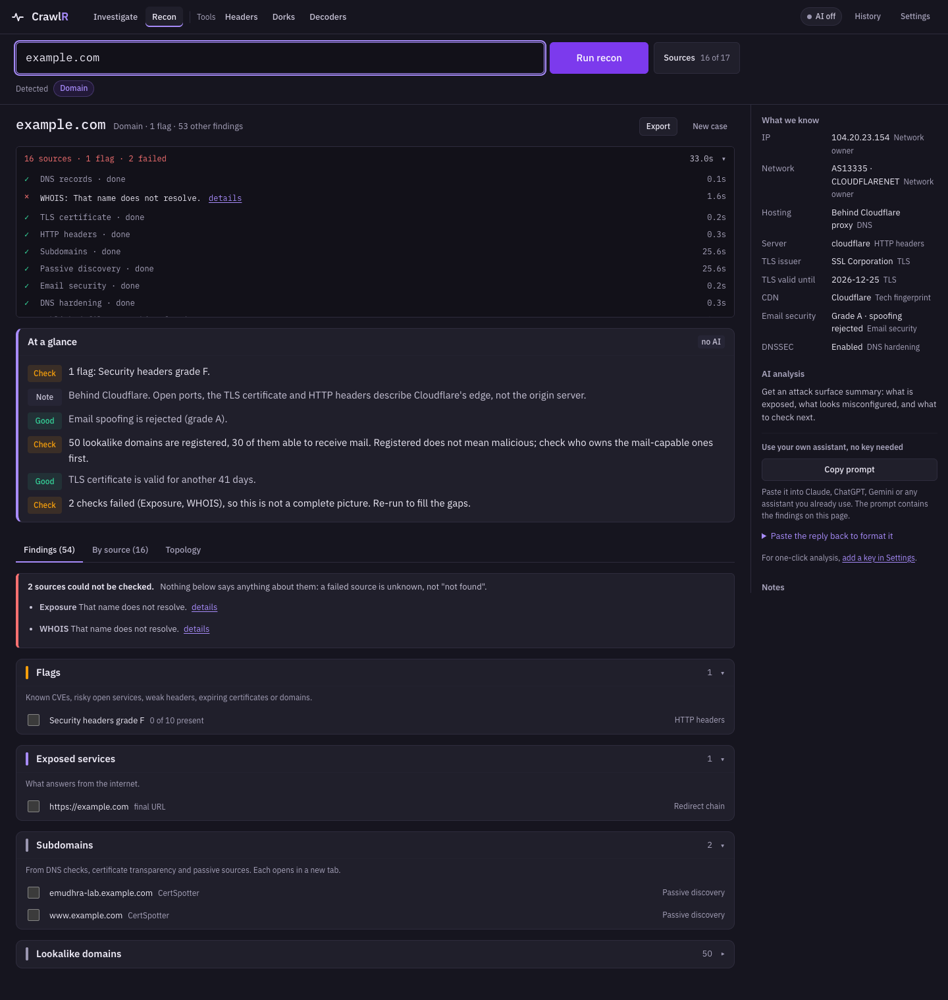

# CrawlR

   

> OSINT investigation in your browser. No install, no account, no API key. Bring your own key when you want more.

**[crawlr.lol](https://crawlr.lol)**

Type a username, email, domain, IP, ASN, phone number or hash. CrawlR detects the target type, runs the right public sources in parallel, and ranks what comes back by how much it tells you. An optional AI report turns the evidence into an investigation summary with next steps.

| Investigate | Recon |
|---|---|
|  |  |

## Who it is for

- Security researchers and pentesters mapping a footprint or attack surface
- Incident responders checking suspicious email headers, hashes and infrastructure
- Journalists and investigators correlating usernames, emails and aliases
- CTF and Trace Labs players who need fast, consolidated OSINT

## Modes

| Mode | Input | What you get |
|---|---|---|
| **Investigate** | Username, email, name, phone, hash | Accounts, breaches, profiles and facts ranked into flags, linked, exists (matches), exists (different person), unverified and known noisy sites. Profiles are grouped by person, so facts from someone who merely shares the handle are kept apart. A source that fails is shown as failed, never as "not found". AI report on request |
| **Recon** | Domain, IP or ASN | DNS, WHOIS, TLS, header grade, subdomains, email spoofing check, takeover candidates, lookalike domains, certificate history, ASN and prefixes, exposure data, a topology graph you can pivot from, optional top-20 port check |
| **Headers** | Raw email headers | SPF, DKIM and DMARC results, hop-by-hop route with delays, sender origin, spoofing and phishing flags, verdict |
| **Dorks** | Name, username, email, location, employer, keywords | A Google dork built live, with site filters; open it or copy it |
| **Decoders** | Text | Base64, URL encoding, string hashing, VIN decode (NHTSA) |

### Investigate sources

| Source | What it does | Key |
|---|---|---|
| Sherlock | Username across 450+ sites, from the site list that ships with the installed package. Adult and dating sites are left out unless you switch them on for the case | None |
| Maigret | Username across the top 500 sites. Reads profile data where it can, which is what lets an account be compared with the others. Adult and dating sites are left out unless you switch them on for the case; then a second pass covers every site with those tags | None |
| Adult site check | Opt-in, off on every page load and never stored; once switched on it stays on until you switch it off or reload. Existence checks on named adult and dating platforms, decided from page content. Text only: no picture or post is ever loaded. Asked only after the ordinary sources, and refused when the handle states an age under 18 or a profile found for it suggests a minor (the page and the server both check; the server keeps the profile text for 30 minutes, in memory and per caller, to do so) | None |
| Holehe | Which services an email is registered with | None |
| Domain harvest | Hosts and addresses on an email's domain (crt.sh, CertSpotter, HackerTarget, RapidDNS, urlscan, OTX, Anubis, Wayback) | None |
| Breaches | Known breaches for an email (XposedOrNot), with date, data classes, record count and a link, newest first | None |
| GitHub | Profile, repos, linked email. A details lookup adds organisations, top repositories and languages, linked social accounts, README links, key fingerprints and public commit emails. Rate limits are reported as rate limits | None (optional server `GITHUB_TOKEN`) |
| Gravatar | Profile and avatar for an email | None |
| Name search | Type a name, with an optional location, employer or keyword that only ranks the answer. CrawlR lists the people with that name on Wikidata (with the Wikipedia link), GitHub, ORCID, OpenAlex and Bluesky as candidates, says how each name fits and which details it matches, and suggests handles such a person might use. Nothing is followed on its own: "Show profile" loads one GitHub profile, "Investigate this" starts a username case for one handle, and the people-search and search engine links only open in a new tab. A directory that could not be asked is shown as unknown. Text only, no pictures | None (optional server `GITHUB_TOKEN`) |
| Platform check | Instagram, X, Threads, TikTok, Facebook and LinkedIn, decided from what the page says, not from the status code. A site that walls the request is shown as "Blocked by site". Reddit and Discord are asked directly and are always listed: Reddit refuses servers, so without the optional credentials its row says "Blocked by site" and links the profile to open by hand; Discord has no profile page, so its sign-up check can only say "Handle taken", with the owner unknown | None (optional server `REDDIT_CLIENT_ID` and `REDDIT_CLIENT_SECRET`) |
| Similar handles | A username or email case lists up to 16 handles close to the searched one (a digit read as a letter, a separator or a number taken off, a decoration removed, handles built from the name on the primary profile). Nothing is requested until you click "Check" on one, and one click checks one handle: GitHub, the platform check and Bluesky, never Sherlock or Maigret. Each profile that was read says whether its picture, a link or its name lines up with the case, by the same rules that group the case's own profiles. One that lines up can be added to the case with a click, and removed again | None |
| Link check | Opens each reported profile URL once to see whether the page really exists, when you open a group. Marks links as checked, not found, blocked by the site or unclear. Can be switched off under Sources | None |
| Avatar comparison | Fingerprints public profile pictures so two accounts with the same picture can be linked. Placeholder pictures are ignored | None |
| Profile scraper | Bios, display names and links from found profiles (active technique, off by default) | None |
| Hash lookup | CIRCL, AlienVault OTX, and MalwareBazaar and ThreatFox when the server has an abuse.ch key. Recognises the EICAR test file. Community tags are kept apart from malware families | None (optional server `ABUSECH_AUTH_KEY`) |
| Phone lookup | What a number is, with no key: whether it is valid, how it is written, its country, line type, time offset, and where and to whom its number range was assigned (libphonenumber, offline). For United States and Canadian numbers, the rate centre and first assignee of the block from Local Calling Guide, which is asked for the area code and exchange only. Flags for premium-rate, VoIP, personal, fiction and invalid ranges, short codes and emergency numbers. A number typed without a country code is read as the country picked in the Country select. Search links to search engines and free spam-report sites. It never says who uses a number, and links to no data broker | None. An optional NumLookup key adds the current carrier |
| Hunter.io | Email addresses and patterns for a domain | Your key |
| At a glance | A short written brief built from rules, with no AI: what stands out, what is uncertain, what failed | None |
| AI analysis and deep dive | Investigation report: identity, accounts, exposure, next moves. Runs only when you ask, and shows what it costs first | Free tier, your key, or no key at all (copy the prompt into an assistant you already use) |

### Recon sources

| Source | What it does | Key |
|---|---|---|
| DNS | A, AAAA, MX, NS, TXT, CNAME, SOA, Cloudflare detection | None |
| WHOIS | Registrar, dates, nameservers, privacy | None |
| TLS | Issuer, SANs, expiry | None |
| HTTP headers | Server info and a security-header grade | None |
| Subdomains | DNS plus certificate transparency. Detects wildcard DNS first, so a name that only resolves because every name does is not listed as a subdomain | None |
| Email security | SPF, DMARC, DKIM selectors, MTA-STS, TLS-RPT, BIMI, with a grade and a plain answer to "can this domain be spoofed?" | None |
| DNS hardening | CAA, DNSSEC, wildcard DNS, reverse DNS | None |
| Takeover candidates | Subdomains whose CNAME points at a claimable cloud service, split into dangling and pointing. DNS only | None |
| Lookalike domains | Registered typo, lookalike-character and TLD variants, mail-capable ones first. DNS only | None |
| Certificate history | Issuance timeline, issuers, and certified names that no longer resolve | None |
| Published files | security.txt, robots.txt paths worth a look, favicon hash for Shodan pivots | None |
| ASN / BGP | IP to ASN, org, prefixes (RIPE, ARIN RDAP) | None |
| Port check | Top 20 TCP ports (active technique, off by default) | None |
| InternetDB | Open ports, CVEs, hostnames (Shodan InternetDB) | None |
| Shodan | Banners, org, geo | Your key |
| Wayback, redirects, tech fingerprint | History, archived paths worth a look, redirect chain, detected stack | None |
| At a glance | Rules-based brief of the run, no AI | None |
| Timeline | Every dated fact from the run in order: registration, first certificates, archive copies, upcoming expiries | None |
| AI summary | Attack-surface summary and next steps | Free tier, your key, or no key (copy the prompt) |

## Free tier and your own keys

Every non-AI source runs with no key, and every case gets a written "At a glance" brief that uses no AI at all. AI is opt-in per case: nothing is sent to a model until you press Analyze. Without your own key it runs on a shared Gemini key with a small daily allowance per visitor, and a cached answer or an identical re-run does not use a credit. Add your own key in Settings for unlimited AI (Claude or Gemini) and the Hunter and Shodan sources.

| | Free | With your key |
|---|---|---|
| OSINT and recon sources | All keyless sources | Same, plus Hunter and Shodan |
| AI analysis | 5 per day | Unlimited |
| Deep dive | 1 per day | Unlimited |
| AI provider | Gemini Flash | Claude or Gemini |

**No key at all:** press **Copy prompt** in the AI panel and paste it into Claude, ChatGPT, Gemini or any assistant you already use. Paste the reply back and CrawlR formats it as the same report. Nothing is sent to a model by CrawlR, and no credit is used.

**How keys are handled:** keys stay in your browser's `localStorage`. They are sent with each request to the CrawlR server, which passes them straight to the matching provider. CrawlR does not store them. Use a key with a spending limit.

## Run it yourself

```bash
git clone https://github.com/Err0ric/crawlr
cd crawlr
python3.11 -m venv .venv && source .venv/bin/activate
pip install -r requirements.txt
cp .env.example .env    # optional: GEMINI_API_KEY turns on the free AI tier
uvicorn main:app --reload --port 8000 --env-file .env
```

Open http://localhost:8000. Free-tier, quota, cache, GitHub token, proxy and tool-concurrency settings are documented in [`.env.example`](.env.example).

Run the tests:

```bash
pip install pytest && pytest -q
for f in static/v2/js/*.js; do node --check "$f"; done
node tests/js/detect.test.mjs
node tests/js/contrast.test.mjs
node tests/js/brief.test.mjs
node tests/js/timeline.test.mjs
node tests/js/casefile.test.mjs
node tests/js/identity.test.mjs
node tests/js/evidence.test.mjs
node tests/js/links.test.mjs
node tests/js/adult.test.mjs
node tests/js/modes.test.mjs
node tests/js/names.test.mjs
node tests/js/design.test.mjs
node tests/js/phone.test.mjs
node tests/js/similar.test.mjs
node tests/js/wildcard.test.mjs
```

## How it is built

FastAPI on Python 3.11 serves a vanilla JavaScript frontend (no build step) and a JSON API. The browser runs sources in parallel and ranks the results. Fonts and the graph library are self-hosted, so the page makes no third-party requests when it loads. Hosted on Railway. See [docs/ARCHITECTURE.md](docs/ARCHITECTURE.md) for the code map, [static/v2/DESIGN.md](static/v2/DESIGN.md) for the design system and [docs/research.md](docs/research.md) for the comparison with other OSINT tools and the feature proposals.

## Privacy

- No accounts, no analytics, no tracking.
- Investigation history and notes stay in your browser. Exports (Markdown, HTML, print to PDF and a JSON case file) are built in the browser too.
- A case file opens on another machine from History. It is read in the browser and never uploaded.
- Each case has an optional purpose line that is saved with it and printed on every export.
- The server keeps no record of what you look up: targets are not written to its logs. When the minor check blocks, one log line names the rule that fired and nothing about the target. Short-lived in-memory caches (AI answers, GitHub profiles, and for 30 minutes the profile text a username run returned, which the minor check reads) are lost on restart.
- One random session cookie keeps the minor check tied to your own run. It identifies nothing about you and ends with the browser session.
- Active techniques that connect to the target's own systems (the port scan, profile scraping for deep dive) are off on every page load, never stored, and labeled.

## Responsible use

The full acceptable-use statement is in the app under Settings. For lawful purposes only: your own accounts, authorized assessments, research, journalism and missing-persons work. You accept these terms before first use. Results come from third parties and can be wrong. "Possible" findings are leads, not facts, and a confirmed account shows that a handle exists, not who owns it.

## Security

Found a vulnerability? See [SECURITY.md](SECURITY.md).

## Roadmap

Ranked proposals with sources are in [docs/research.md](docs/research.md). Next candidates:

- Client-side correlation rules beyond the current brief
- Passphrase-encrypted case files
- Case mode for Trace Labs competitions

## License and author

MIT, see [LICENSE](LICENSE). Built by Eric Henderson, [github.com/Err0ric](https://github.com/Err0ric).
